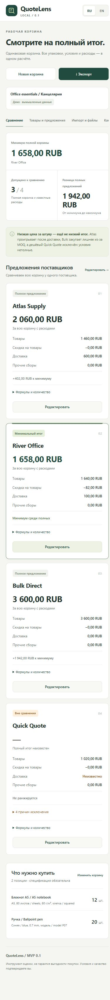

# QuoteLens

**RU/EN supplier comparison for the full cost of one small basket.** Browser-local arithmetic, whole packs, minimum orders, delivery, explicit fees and discounts. No account, quote uploads, AI, OCR or paid API.

[Live demo](https://moyisey.github.io/quotelens/) · [CSV schema](docs/CSV.md) · [Checks and limits](QA.md)



## Run locally

Node.js **22+**; tested on Node 24. No external npm dependencies and no installation step.

```sh
git clone https://github.com/MOYISEY/quotelens.git
cd quotelens
npm test
npm run check
npm run build
npm start
```

Open `http://127.0.0.1:4173`. For another port: `node scripts/serve.mjs --dist --port 4827`. `npm run dev` serves source files. The server listens on loopback and serves an explicit static allowlist. Stop with Ctrl+C.

## What it compares

- One complete basket, **1–12 discrete items**, **2–4 suppliers**.
- Required quantity and exact item specification; quote price per unit or per full pack.
- Whole packs, MOQ **in item units**, optional known stock, delivery per order, all other mandatory fees, goods discount and minimum goods value before discount.
- Purchase quantity, surplus, visible formulas, complete totals, differences and conditions.
- One comparison currency: RUB, USD, EUR or GBP (two decimal places). Mismatched currencies and units are excluded; there are no automatic conversions.

**Unknown delivery is not zero.** Blank or invalid mandatory costs, missing lines, insufficient known stock, unmet order minimums and unconfirmed comparability exclude the supplier. Every item needs manual confirmation of equivalent product and quality, and each supplier needs confirmation that all mandatory costs are included. At least two eligible quotes are required to show a comparison minimum. Ties are explicit.

The first visit contains fictional data: River Office totals 1,658 RUB; Atlas totals 2,060 after delivery; Bulk totals 3,600 because of packs/MOQ; cheap Quick Quote is excluded because its terms are incomplete. Use **New basket** for your own inputs. The UI supports Russian and English on desktop and mobile.

## Exact calculation

```text
packs = ceil(max(required, MOQ_in_units) / units_per_pack)
buy = packs × units_per_pack
surplus = buy − required
line = half_up(buy × unit_price, 2)
  or half_up(packs × pack_price, 2)
goods = sum(rounded_lines)
discount = half_up(goods × discount_percent / 100, 2)
total = goods − discount + delivery + fees
```

Money uses integer `BigInt` arithmetic. Prices accept up to 4 decimals; costs and discounts up to 2. Decimal point or comma is accepted, without grouping separators or exponents. Quantities are integers up to 1,000,000; required/pack quantities must be positive. MOQ and known stock may be zero. Prices and individual costs are capped at 100,000,000. Zero price is allowed; negatives are invalid. Discount is 0–100%, applied only to goods, so it cannot create a negative total.

Minimum goods value is checked **before discount**; no automatic top-up. Known availability must cover the entire purchase quantity including packs. Blank availability is explicitly unverified. Enter conditional delivery/discounts/fees manually for the applicable order. All entered costs are assumed final for the calculated volume.

## Import, backup and export

- [CSV template](examples/template.csv): UTF-8, comma delimiter, 22 columns, one item × supplier row. Repeated item data and supplier terms must agree. Preview before replacing the basket; the previous version is available for undo. CSV import resets comparability and cost confirmations.
- **Backup JSON** preserves all inputs, manual confirmations and the distinction between unknown (`""`) and explicit zero (`"0"`). Use it to restore the basket. [Synthetic demo backup](examples/demo-backup.json).
- **Calculation JSON** contains input and exact integer minor-unit results; **results CSV** is a human-readable table. These reports are separate from backup/input formats.
- Formula-like CSV text is prefixed with an apostrophe to discourage spreadsheet formula execution. Use JSON for an exact text roundtrip.
- Files are limited to 1,000,000 bytes; pasted input to 1,000,000 characters. Unsupported or inconsistent imports are rejected before applying. Oversized pasted text is discarded.

Reference example: restore [20-unit basket](examples/reference-20-units.json). A = 380,000; B = 390,000; C = 388,000 with 4 surplus units; D has only 18 units and is excluded. A has the lowest complete total despite a higher unit price than B.

## Privacy and storage

Quote data is processed in your browser. There is no application data API, telemetry, external font or third-party script. CSP blocks data connections (`connect-src 'none'`). Static hosting receives normal page/asset requests; the app does not upload your basket or imported files.

Browser `localStorage` belongs to the current origin/profile and is not encrypted. Clearing browser data, changing origin/port or using another profile can lose access to a basket. Export JSON backups. Storage errors are visible; malformed saved data is not silently overwritten. Work in one tab: an external storage change stops autosave and shows a conflict warning. This is conflict detection, not a transactional lock. Undo holds one prior replacement/deletion, not a full version history.

## Limits

This is an **estimation tool, not a guarantee of a good purchase**. The user verifies product identity, quality, source numbers and completeness of costs. Only discrete items and one full basket per supplier are supported. No weight-unit conversion, exchange rates, tax advice, tiered-price optimization, automatic free-shipping thresholds, split-order optimization or purchasing integration. No installed offline/PWA mode: reloading needs the static site or local server.

Supplier comparison and transparent pack/MOQ arithmetic already exist in other products and spreadsheets. This MVP makes no claim of uniqueness or proven demand.

## Кратко по-русски

QuoteLens показывает полную стоимость одинаковой небольшой корзины у 2–4 поставщиков. Укажите спецификацию, количество, цену за единицу/упаковку, размер упаковки, MOQ **в единицах**, доставку, обязательные сборы и скидку на товары. Подтвердите сопоставимость каждой позиции и полноту расходов. Пустой расход означает «неизвестно»; ноль вводится явно. Неполные и несовместимые предложения исключаются из ранжирования.

Формулы и излишек видны в карточках. Деньги считаются точно через BigInt. Данные остаются в браузере; экспортируйте JSON-копию. После CSV-импорта подтверждения нужно проверить заново. Это локальный инструмент оценки, не гарантия выгодности покупки. Переключатель RU/EN находится в шапке.
